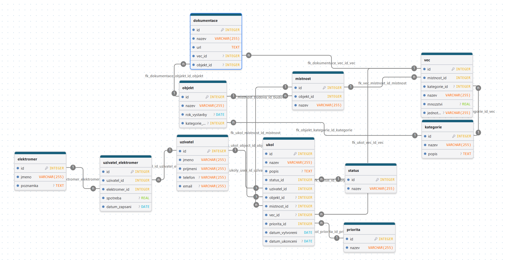

# Databáze pro lepší management dění na chalupě

## 1. Nápad a popis systému

### Popis
Databáze slouží pro ukládání a sledování věcí, zásob a dění na chalupě. Na chalupě se často vypotřebují určité materiály či rozbijí věci, které je třeba nahradit – ať už jde o smrkové desky, hřebíky nebo rozbité topůrko. Stejně tak určování priorit, co je třeba udělat hned a co počká, zabere nějaký ten čas; tato databáze má usnadnit i plánování díky zadávání úkolů s prioritou a stavem řešení.

Dále se usnadňuje zápis a rozúčtování elektřiny. V objektu, který sdílí elektroměr, může být buď jedna rodina, druhá rodina, nebo obě zároveň. Dříve se vše počítalo a zapisovalo ručně do papírového deníku na chalupě, což zabíralo čas. Nyní bude vše v online databázi, ke které je přístup odkudkoliv, a konečné součty spotřeby na jednotlivé uživatele lze automatizovat.

V neposlední řadě databáze řeší problém s údržbou a dosavadní špatnou dokumentací. Udržet statek o několika objektech dá zabrat – některé věci je třeba opravovat celoročně a některé jednou za 10 či 20 let. Informace, revizní zprávy a návody k opravám se často ztratí nebo zapomenou; nyní budou ukládány přímo do databáze a usnadní celý proces i pro budoucí generace.

## 2. Relační schéma
<div style="display: flex; justify-content: center;">
    
</div>

## 3. Popis tabulek

* **`uzivatel`** – Eviduje členy rodiny a správce chalupy (jméno, příjmení, telefon, e-mail), kteří zadávají úkoly nebo vykazují spotřebu elektřiny[cite: 7].
* **`kategorie`** – Číselník kategorií (např. *Budovy*, *Nářadí*, *Materiál*, *Palivo*) sloužící ke třídění objektů i uložených věcí[cite: 7].
* **`objekt`** – Hlavní stavby a celky v areálu (např. *Obytná chalupa*, *Stodola*, *Studna*) včetně roku výstavby a zařazení do kategorie[cite: 7].
* **`mistnost`** – Konkrétní místnosti a vnitřní prostory patřící pod daný objekt (např. *Dílna*, *Půda*, *Kuchyň*)[cite: 7].
* **`vec`** – Eviduje nářadí, vybavení a spotřební materiál v konkrétních místnostech, včetně aktuálního množství a měrné jednotky (např. `ks`, `m3`, `kg`)[cite: 7].
* **`elektromer`** – Seznam měřidel elektřiny v areálu (název a poznámka o tom, které budovy měřidlo pokrývá)[cite: 7].
* **`uzivatel_elektromer`** – Vazební tabulka (M:N) zaznamenávající spotřebu elektřiny konkrétního uživatele na daném elektroměru k určitému datu[cite: 7].
* **`status`** – Číselník stavů úkolu (`active`, `in_progress`, `done`, `canceled`)[cite: 7].
* **`priorita`** – Číselník úrovní naléhavosti úkolu (`low`, `medium`, `high`)[cite: 7].
* **`ukol`** – Sjednocená evidence plánovaných prací a deníku oprav; obsahuje zadavatele, stav, prioritu, data vytvoření/ukončení a volitelné napojení na objekt, místnost nebo věc[cite: 7].
* **`dokumentace`** – Úložiště odkazů (URL) na manuály, video návody a revizní dokumenty napojené na konkrétní věc nebo objekt[cite: 7].

## 4. SQL skript pro tvorbu schématu

```sql
CREATE TABLE uzivatel (
    id SERIAL PRIMARY KEY,
    jmeno VARCHAR(255) NOT NULL,
    prijmeni VARCHAR(255) NOT NULL,
    telefon VARCHAR(255),
    email VARCHAR(255)
);

CREATE TABLE kategorie (
    id SERIAL PRIMARY KEY,
    nazev VARCHAR(255) NOT NULL,
    popis TEXT
);

CREATE TABLE objekt (
    id SERIAL PRIMARY KEY,
    nazev VARCHAR(255) NOT NULL,
    rok_vystavby DATE,
    kategorie_id INTEGER REFERENCES kategorie(id)
);

CREATE TABLE mistnost (
    id SERIAL PRIMARY KEY,
    objekt_id INTEGER NOT NULL REFERENCES objekt(id),
    nazev VARCHAR(255) NOT NULL
);

CREATE TABLE vec (
    id SERIAL PRIMARY KEY,
    mistnost_id INTEGER NOT NULL REFERENCES mistnost(id),
    kategorie_id INTEGER REFERENCES kategorie(id),
    nazev VARCHAR(255) NOT NULL,
    mnozstvi REAL,
    jednotka VARCHAR(255)
);

CREATE TABLE elektromer (
    id SERIAL PRIMARY KEY,
    jmeno VARCHAR(255) NOT NULL,
    poznamka TEXT
);

CREATE TABLE uzivatel_elektromer (
    id SERIAL PRIMARY KEY,
    uzivatel_id INTEGER NOT NULL REFERENCES uzivatel(id),
    elektromer_id INTEGER NOT NULL REFERENCES elektromer(id),
    spotreba REAL,
    datum_zapsani DATE
);

CREATE TABLE status (
    id SERIAL PRIMARY KEY,
    nazev VARCHAR(255) NOT NULL
);

CREATE TABLE priorita (
    id SERIAL PRIMARY KEY,
    nazev VARCHAR(255) NOT NULL
);

CREATE TABLE ukol (
    id SERIAL PRIMARY KEY,
    nazev VARCHAR(255) NOT NULL,
    popis TEXT,
    status_id INTEGER NOT NULL REFERENCES status(id),
    uzivatel_id INTEGER NOT NULL REFERENCES uzivatel(id),
    objekt_id INTEGER REFERENCES objekt(id),
    mistnost_id INTEGER REFERENCES mistnost(id),
    vec_id INTEGER REFERENCES vec(id),
    priorita_id INTEGER NOT NULL REFERENCES priorita(id),
    datum_vytvoreni DATE NOT NULL,
    datum_ukonceni DATE
);

CREATE TABLE dokumentace (
    id SERIAL PRIMARY KEY,
    nazev VARCHAR(255) NOT NULL,
    url VARCHAR(255) NOT NULL,
    vec_id INTEGER REFERENCES vec(id),
    objekt_id INTEGER REFERENCES objekt(id)
);
```

## Sample naplneni daty
```sql
-- Uživatelé
INSERT INTO uzivatel (jmeno, prijmeni, telefon, email) VALUES
('Jan', 'Novák', '+420 777 111 222', 'jan.novak@email.cz'),
('Petra', 'Svobodová', '+420 608 333 444', 'petra.svobodova@email.cz'),
('Karel', 'Dvořák', '+420 724 555 666', 'karel.dvorak@email.cz');

-- Kategorie
INSERT INTO kategorie (nazev, popis) VALUES
('Budovy', 'Obytné i hospodářské stavby v areálu'),
('Nářadí', 'Ruční i elektrické nářadí a zahradní technika'),
('Materiál a palivo', 'Spotřební stavební materiál a palivové dřevo');

-- Objekty
INSERT INTO objekt (nazev, rok_vystavby, kategorie_id) VALUES
('Obytná chalupa', '1924-06-15', 1),
('Stodola a dřevník', '1935-09-01', 1);

-- Místnosti
INSERT INTO mistnost (objekt_id, nazev) VALUES
(1, 'Kuchyň'),
(1, 'Sklep'),
(2, 'Dílna'),
(2, 'Dřevník');

-- Věci
INSERT INTO vec (mistnost_id, kategorie_id, nazev, mnozstvi, jednotka) VALUES
(3, 2, 'Motorová pila Stihl MS 251', 1, 'ks'),
(3, 3, 'Hřebíky stavební 100mm', 150, 'ks'),
(4, 3, 'Nasekané dubové dřevo', 4.5, 'm3');

-- Elektroměry
INSERT INTO elektromer (jmeno, poznamka) VALUES
('Hlavní rozvaděč venku', 'Měří spotřebu pro chalupu i stodolu'),
('Podružný elektroměr chalupa', 'Měří pouze spotřebu obytné chalupy');

-- Spotřeba elektřiny uživatelů
INSERT INTO uzivatel_elektromer (uzivatel_id, elektromer_id, spotreba, datum_zapsani) VALUES
(1, 1, 42.5, '2026-10-18'),
(2, 1, 42.5, '2026-10-18'),
(1, 2, 18.0, '2026-11-02'),
(3, 1, 65.0, '2026-11-15');

-- Číselníky status a priorita
INSERT INTO status (nazev) VALUES ('active'), ('in_progress'), ('done'), ('canceled');
INSERT INTO priorita (nazev) VALUES ('low'), ('medium'), ('high');

-- Úkoly a opravy
INSERT INTO ukol (nazev, popis, status_id, uzivatel_id, objekt_id, mistnost_id, vec_id, priorita_id, datum_vytvoreni, datum_ukonceni) VALUES
('Výměna řetězu a seřízení pily', 'Koupit nový řetěz 3/8 a promazat lištu', 1, 1, 2, 3, 1, 3, '2026-11-10', NULL),
('Oprava zatékání u komína', 'Vyměněno oplechování a zasilikonováno', 3, 3, 1, NULL, NULL, 3, '2026-09-05', '2026-09-12'),
('Doštípat dřevo na zimu', 'Doplnit zásobu v dřevníku alespoň na 5 m3', 2, 2, 2, 4, 3, 2, '2026-11-01', NULL);

-- Dokumentace
INSERT INTO dokumentace (nazev, url, vec_id, objekt_id) VALUES
('Manuál k motorové pile Stihl MS 251', '[https://example.com/manual-stihl-ms251.pdf](https://example.com/manual-stihl-ms251.pdf)', 1, NULL),
('Revizní zpráva komína 2026', '[https://example.com/revize-komin-2026.pdf](https://example.com/revize-komin-2026.pdf)', NULL, 1);
```

## Sample sql select
```sql
SELECT 
    u.nazev AS ukol,
    p.nazev AS priorita,
    s.nazev AS stav,
    o.nazev AS objekt,
    m.nazev AS mistnost,
    v.nazev AS vec,
    uz.jmeno || ' ' || uz.prijmeni AS zadal,
    u.datum_vytvoreni
FROM ukol u
JOIN status s ON u.status_id = s.id
JOIN priorita p ON u.priorita_id = p.id
JOIN uzivatel uz ON u.uzivatel_id = uz.id
LEFT JOIN objekt o ON u.objekt_id = o.id
LEFT JOIN mistnost m ON u.mistnost_id = m.id
LEFT JOIN vec v ON u.vec_id = v.id
WHERE s.nazev != 'done'
ORDER BY u.priorita_id DESC, u.datum_vytvoreni ASC;
```
